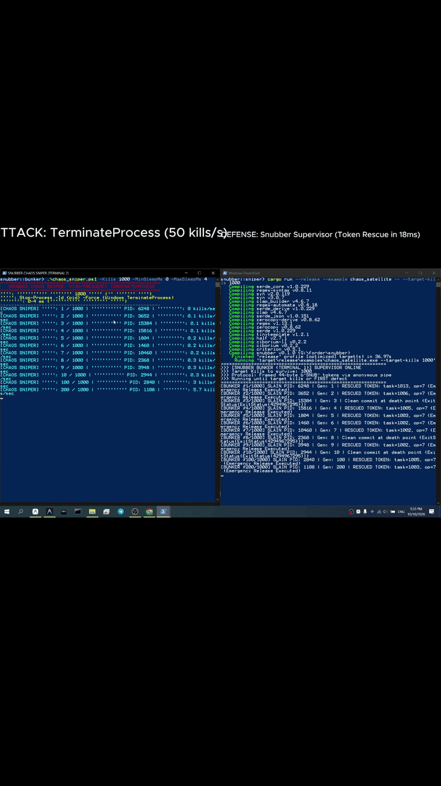

# snubber

[](https://github.com/Ar3ss12/snubber/actions/workflows/ci.yml)
[](https://crates.io/crates/snubber)
[](https://docs.rs/snubber)
[](#license)
[]()

> **Transactional safety fuse and failure-recovery engine for Rust.**  
> Guarantees that if your function fails — through a panic, an early return `?`, or unexpected process termination — physical pins, database locks, and memory resources automatically reset to a safe state via `Drop`.

Zero external dependencies. `#![forbid(unsafe_code)]`. Compatible from bare-metal embedded firmware (`core`-only) to high-throughput multi-threaded servers (`std`).

<p align="center">
  
</p>

---

## ⚡ Quickstart (10 seconds)

Add to `Cargo.toml`:
```toml
[dependencies]
snubber = "0.5"
```

Wrap critical work in **`scoped`** — commits on `Ok`, automatically rolls back on `Err` or `panic!`:

```rust
use snubber::{snub_check, SnubberNode};

let node = SnubberNode::desktop("orders");

let receipt = node.scoped_checked(
    &payment_request,
    |req| {
        snub_check!(req.amount > 0, "amount must be positive");
        Ok(())
    },
    || ledger.unlock_funds(),      // emergency rollback if work fails
    |req| gateway.charge(req),     // protected work unit
)?;
```

---

## 🛡️ Architecture & Guarantees

* **Zero-Boilerplate RAII Rollback:** No manual token tracking. Scoped executions auto-commit on success and guarantee resource release via `Drop` on panics, errors, or early returns.
* **Sub-Nanosecond Overhead:** Base stack guard costs **~1.5 ns** and adds **+0 bytes** to executable size. Concurrency-limited nodes process over **13.8M ops/sec** (`core`-only / `std`).
* **Strict Determinism:** `#![forbid(unsafe_code)]`, zero external dependencies. Predictable behavior across bare-metal microcontrollers and multi-socket servers alike.
* **Runtime-Agnostic Async:** Bounded waker queue built on `core::task::Waker` consuming **0% CPU** without depending on Tokio, async-std, or background threads.
* **Adaptive Backpressure & Pacing:** Refusals carry physical telemetry (`retry_after_ms`, queue depth 0..255) allowing clients to pace incoming traffic instead of overwhelming dead hardware.
* **Out-of-Process Crash Recovery:** Automated stress harness verifies resilience through 10,000 hard Windows `TerminateProcess` (`kill -9`) executions with zero pipe deadlocks and 100% token rescue.
* **Isolated Error Domains:** `FaultKind::is_catastrophic()` cleanly separates unrecoverable failures (Panic, Timeout, ProcessDied, ImplicitDrop) from routine capacity shedding (bulkhead limits, rate limits, stale epochs). Shedding pressure never trips circuit breakers.
* **Monotonic Hang Clock:** Boot-relative `Instant` (`SystemClock`) — NTP sync, DST changes, and manual edits never move a deadline. Firmware brings its own `SysTick` tick via `MonotonicMs`.
* **SPIN vs SLEEP Classification:** A hot `loop {}` settles as `SpinDetected`, a blocked syscall as `TimedOut` — identical rollback, distinct verdict, no thread ever killed. 8-byte `WorkerPulse` heartbeat strokes the hardware WDT on firmware.
* **Zero-Allocation Telemetry:** 512-byte diagnostic snapshots with CRC32 integrity, zero heap allocations on the hot path, and CI validation via `assert_no_anomalies!()`.

---

## 🏎️ Benchmark Snapshot

Measured on AMD Ryzen 5 4600H release build
(`cargo bench --bench admission_bench`, Criterion: 800 ms warmup,
2 s measurement, 50 samples, isolated node per bench):

| Operation | Architecture Layer | Average Latency | Notes |
|---|---|---|---|
| `SnubberGuard::new` + `commit` | Layer 1 (`core`) | **~1.5 ns** | Pure stack move, zero heap allocation |
| `EpochGate::observe` | Layer 1 (`core`) | **~2.6 ns** | 2-D generation + monotonic epoch filter |
| `classify_stall` / `classify_stall_ceiling` | Layer 1 (`core`) | **~0 ns** (const math) | `SpinDetected` / `SleepBlocked` / `DeadlockSuspected` from one sample pair |
| `node.enter + commit` | Layer 2 (`std`) | **~72.6 ns** | Full bulkhead, circuit breaker, auto-commit |
| `node.enter_auto + commit` | Layer 2 (`std`) | **~86.5 ns** | + atomic sequence minting |
| `node.enter_with_priority(Critical)` | Layer 2 (`std`) | **~73.6 ns** | Priority lane: +1 ns over plain enter |
| `node.transition` | Layer 2 (`std`) | **~86.5 ns** | ONE-enum state machine, zero flag drift |
| `node.transition_checked` + `LegalMove` | Layer 2 (`std`) | same + 0 ns | Closed state graphs: illegal moves fail at compile time (E0277) |
| `enter_erased_auto` | Layer 2 (`alloc`) | **~85.6 ns** | Boxed rollback for dynamic struct fields |
| `enter_async_auto` | Layer 3 (`std`) | **0% CPU** | Pure `core::task::Waker` parking, no runtime deps |
| `static_node.enter + commit` | Layer 2 (`std`) | **~91.9 ns** | Compile-time capacity assert + bulkhead + auto-commit |
| `node.note_pulse_stall(lag_ms)` | Layer 2 (`std`) | **1 atomic max** | Missed heartbeat lands in `SnapshotV1` v3 + `AnomalyKind::PulseStall` |
| `process_token.to_bytes()` | Layer 4 (`core`) | **~7.5 ns** | 44-byte framed wire serialization (`to_le_bytes`) |
| `state_digest.crc()` | Layer 4 (`core`) | **~261 ns** | 64-byte hardware cache line digest verification |
| `snapshot_v1.encode()` | Layer 5 (`core`) | **~1.1 µs** | 512-byte zero-allocation snapshot CRC32 codec |
| `snapshot_v1()` + `find_anomalies()` | Layer 5 (cold) | **512 B, CRC32** | Zero-allocation telemetry; `assert_no_anomalies!()` CI gate |

### ⚡ Contended Multi-Threaded Latencies (Real Cross-Core Saturation)
Measured with half of available hardware cores active (6 concurrent threads under contention, AMD Ryzen 5 4600H):

| Contended Operation | Concurrency | Measured Latency | Physical Phenomenon |
|---|---|---|---|
| `contended_node_enter` | 6 threads | **~452 ns** | L1 cache-line bouncing across physical cores on node mutex |
| `contended_node_scoped` | 6 threads | **~804 ns** | Full transactional cycle under contention (entry + work + auto-commit) |
| `contended_gateway_mpsc` | 6 threads | **~132 ns** | Bounded multi-producer channel write under parallel core flood |
| `cross_thread_isr_bridge` | 2 threads (inter-core) | **~35.6 ns** | Lock-free SPSC ring across physical core boundaries (bus latency) |

---

## 📖 Documentation & Architecture Layers

* 📘 **[Invariants & Verification Protocol (`docs/INVARIANTS.md`)](docs/INVARIANTS.md)** — Formal mathematical guarantees, admission conservation, zero slot leak proofs.
* 📘 **[User Guide (`docs/USER_GUIDE.md`)](docs/USER_GUIDE.md)** — Comprehensive architecture manual:
  * **Layer 1: Core RAII Guard:** Stack rollback, `EpochGate`, and universal ergonomics (`scoped`, `scoped_checked`, `snub_check!`).
  * **Layer 1.5: Hang Classification:** Monotonic clock (`MonotonicMs` / `SystemClock`), CPU-spin classifier (`classify_stall`, `TimedOut` vs `SpinDetected`), 8-byte `WorkerPulse` heartbeat + `WdtSink`, ISR bridge (`IsrBridge`, 80 B SPSC ring + 32-bit trip latch, `IsrBridge::trip` bypasses `Full`), idle-park (`IdlePark` / `wfi`/`wfe` on firmware, `wfe` needs `SEVONPEND=1` at boot), pulse black-box (`pulse_stalls` + `PulseStall` anomaly, snapshot v3).
  * **Layer 2: Concurrency Bulkhead:** `SnubberNode`, presets, token buckets, sliding-window breakers, and priority preemption.
  * **Layer 3: Async Waker Queue:** Runtime-agnostic async execution (`enter_async_auto`, `settle_async`, `enter_paced_async`).
  * **Layer 4: Process Supervisor:** Out-of-process process supervisor, framed IPC tokens, `PipeDrain`, and generation bumps.
  * **Layer 5: Diagnostics & Health:** Zero-allocation telemetry, `SnapshotV1`, anomaly detection, and CI verification gates.

---

## 🧪 Production Patterns

* **[01 Hardware Fuse (`examples/01_hardware_fuse.rs`)](examples/01_hardware_fuse.rs):** Zero-allocation physical interlock safety.
* **[02 Worker Daemon (`examples/02_worker_daemon.rs`)](examples/02_worker_daemon.rs):** Autonomous slot claiming for background workers.
* **[03 Scoped Database (`examples/03_scoped_database.rs`)](examples/03_scoped_database.rs):** Concurrency limits and adaptive backpressure.
* **[04 Async Web Gateway (`examples/04_async_web_gateway.rs`)](examples/04_async_web_gateway.rs):** Runtime-agnostic async entry with pacing metadata.
* **[05 Task Conduit Steering (`examples/05_task_conduit_steering.rs`)](examples/05_task_conduit_steering.rs):** Bi-directional task control and live telemetry.
* **[06 Process Supervisor (`examples/06_process_supervisor.rs`)](examples/06_process_supervisor.rs):** Surviving abnormal child process termination (`kill -9`).
* **[07 State Handoff (`examples/07_state_handoff.rs`)](examples/07_state_handoff.rs):** Crash-resilient successor state digest passing.
* **[08 Hot Standby Failover (`examples/08_hot_standby_failover.rs`)](examples/08_hot_standby_failover.rs):** Zero-framework N+1 standby spare slot failover.
* **[09 Pipeline Supervisor (`examples/09_pipeline_supervisor.rs`)](examples/09_pipeline_supervisor.rs):** Full end-to-end integration of all resilience layers.
* **[10 Persist Snapshot (`examples/10_persist_snapshot.rs`)](examples/10_persist_snapshot.rs):** Crash-safe 512 B frame flush the app owns (tmp write + rename); the crate never touches files.
* **[11 Hang Classifier (`examples/11_hang_classifier.rs`)](examples/11_hang_classifier.rs):** App-side CPU clock backend; hot `loop {}` settles as `SpinDetected`, blocked sleep as `TimedOut` — no thread is ever killed.
* **[12 ISR Bridge (`examples/12_isr_bridge.rs`)](examples/12_isr_bridge.rs):** Hardware interrupt to guard abort via lock-free SPSC ring (80 B, ~2 bus cycles per push) — timer pulse feeds `WorkerPulse`, overcurrent trip latches a bit that bypasses a full ring.
* **[13 Canary Differential (`examples/13_canary_differential.rs`)](examples/13_canary_differential.rs):** Naked `passthrough(true)` leaks vs guarded rescue on a virtual driver — comparative proof stand, zero real hardware moves.

---

## License

Dual-licensed under either:

* MIT license ([`LICENSE-MIT`](LICENSE-MIT) or <https://opensource.org/licenses/MIT>)
* Apache License, Version 2.0 ([`LICENSE-APACHE`](LICENSE-APACHE) or <https://www.apache.org/licenses/LICENSE-2.0>)

at your option.
